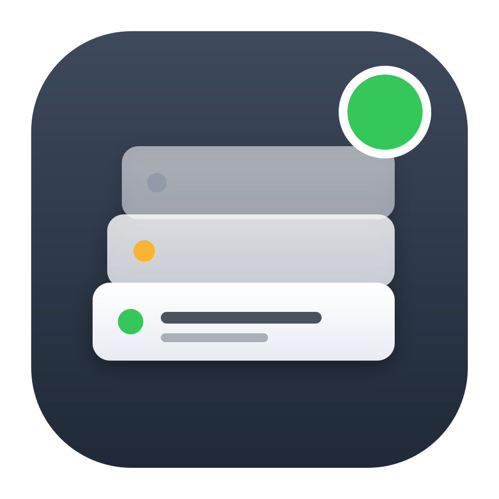
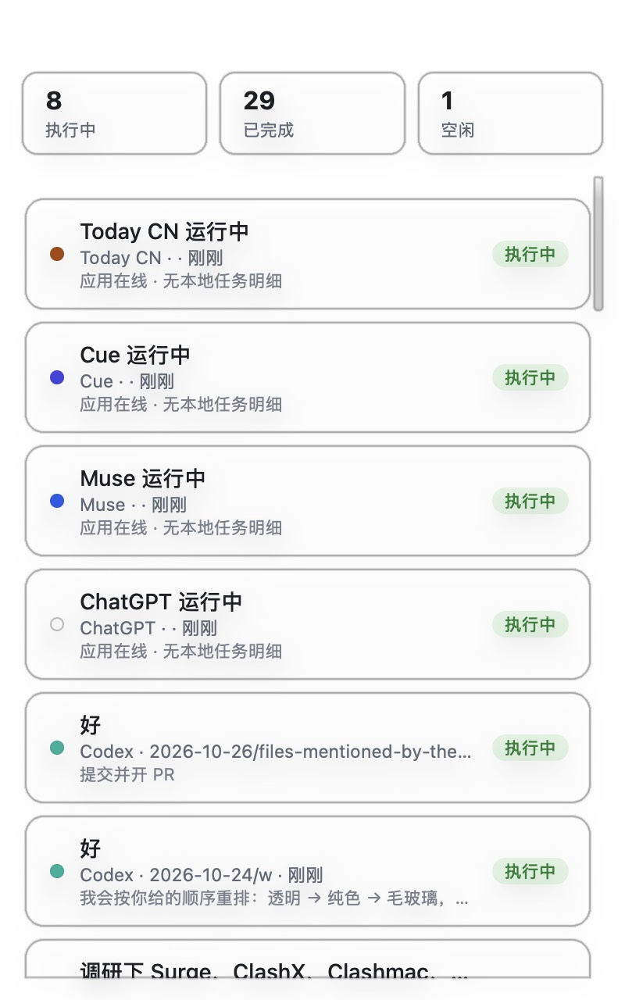
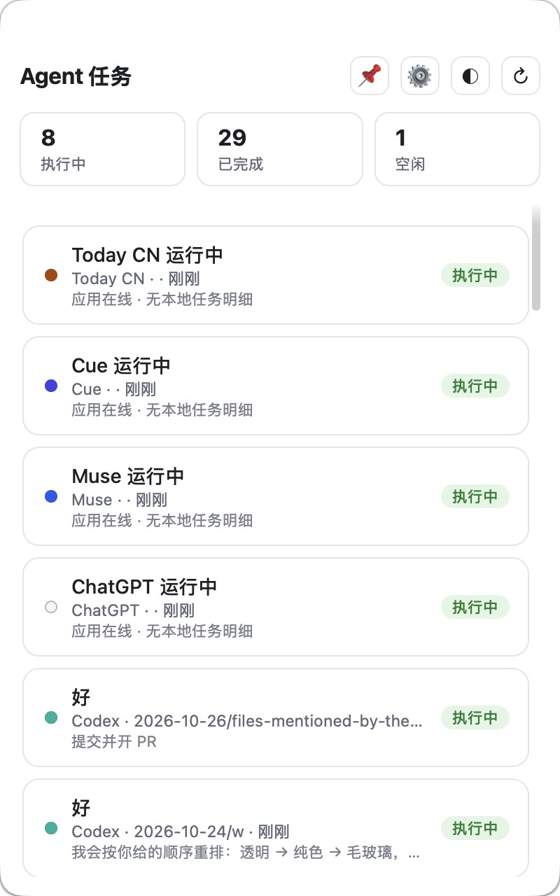
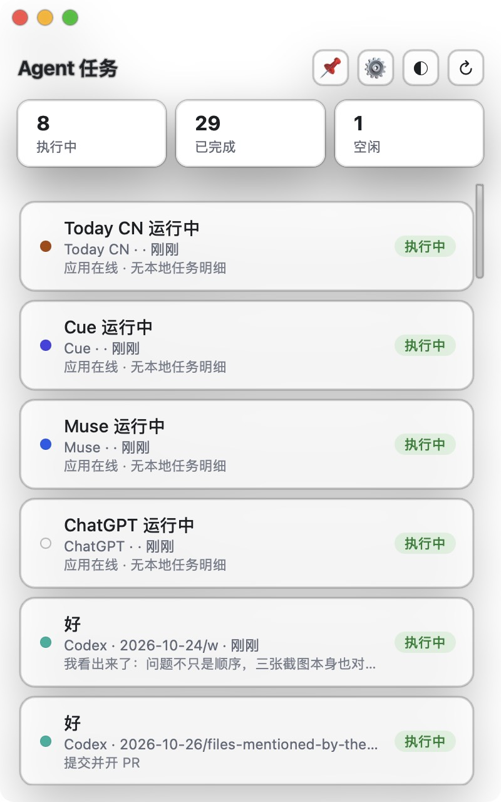

<div align="center">



# AgentTaskPanel

### 一块悬浮面板，看清你所有 AI Agent 的任务状态

**Codex 跑到哪了？Claude Code 完成了没？**<br>
不用再挨个窗口翻。一块常驻面板实时聚合本机所有 AI Agent 的会话状态，<br>
任务结束自动通知，点卡片直接跳回对应的 Agent。

[](https://github.com/jack19941210/agent-task-panel/releases/latest)
[](https://github.com/jack19941210/agent-task-panel/stargazers)
[](LICENSE)


**[项目主页](https://github.com/jack19941210/agent-task-panel)** · [下载最新版](https://github.com/jack19941210/agent-task-panel/releases/latest) · [功能](#功能) · [支持的 App](#支持的-app) · [从源码构建](#从源码构建) · English · *[README](README.md)*

| 透明模式 | 纯色模式 | 毛玻璃模式 |
|---|---|---|
|  |  |  |

</div>

## 安装

> **平台测试状态：目前只有 macOS 版本经过实际使用测试。**
> Windows x64 和 Linux x64 已由 CI 构建并完成打包冒烟检查，但尚未在真实 Windows/Linux
> 设备上验证，请先按预览版对待。

从 [Releases](https://github.com/jack19941210/agent-task-panel/releases/latest) 下载对应平台的安装包：

| 平台 | 安装包 |
|---|---|
| macOS 12+ | `AgentTaskPanel-0.4.1-macos-universal.dmg` |
| Windows x64 | `AgentTaskPanel-0.4.1-win-x64.exe` |
| Linux x64 | `AgentTaskPanel-0.4.1-linux-x86_64.AppImage` |

**macOS**：打开 DMG，把 🤖 AgentTaskPanel 拖进 Applications。若提示「无法验证开发者」，
右键 App → 打开，或终端执行
`xattr -dr com.apple.quarantine /Applications/AgentTaskPanel.app`。

**Windows**：运行安装程序。安装包暂未做代码签名，SmartScreen 可能要求确认。

**Linux**：先添加执行权限，再启动：

```bash
chmod +x AgentTaskPanel-0.4.1-linux-x86_64.AppImage
./AgentTaskPanel-0.4.1-linux-x86_64.AppImage
```

本地数据服务随 App 自动启动。macOS 菜单栏 🤖 图标实时显示执行中任务数；Windows 和
Linux 使用托盘图标。每个 Release 都附带并校验 `SHA256SUMS`。

## 功能

- **实时状态**：每个 Agent 按自身回合边界判断执行中/已完成/空闲，自适应超时只用于降级异常挂起
- **菜单栏常驻**：单色模板图标 + 执行中数量，菜单含显示面板 / 置顶 / 开机自启 / 刷新 / 退出
- **服务守护**：每 5 秒健康检查本地 API，服务意外退出自动拉起，面板不再卡「未响应」
- **三态筛选**：点统计卡筛选执行中/已完成/空闲，再点取消
- **渠道色点**：任务前圆点用各 Agent 专属色，一眼认出来源
- **三态背景**：全透明 → 纯色 → 毛玻璃；透明模式下红绿灯和按钮自动隐藏，鼠标移入浮现
- **默认可点**：面板常驻可操作；需要不挡其他窗口时，在菜单栏打开「自动让路」，划过会淡出并穿透（⌥⌘A 可临时唤起）
- **置顶悬浮**：📌 悬浮在所有窗口（含全屏 Space）之上；首次出现在屏幕右上（菜单栏下方）
- **渠道配置**：⚙️ 勾选哪些 App 显示/隐藏，保存到 `~/.agent-panel-config.json`
- **任务跳转**：点卡片通过 URL scheme 跳回对应 Agent（codex://、cue:// 等）
- **完成通知**：任务从执行中变已完成/堵塞/失败时发系统通知 + 摘要卡（可「稍后提醒」）
- **长任务心跳**：持续执行约 10 分钟后原生侧再提醒一次进展
- **工程分组 / 密度 / 时间线**：面板按 cwd 分组，可切换精简密度与今日跨渠道时间线
- **Cursor 跳转可配**：有工程的会话默认在 IDE 打开，也可设置为 Agents 或先 IDE 再 Agents；无工程的会话直接在 Cursor Agents 打开
- **开机自启**：菜单一键开关，通过 LaunchAgent 实现

## 下一版体验改进（源码）

- 首屏优先显示等待确认和失败，用「待处理 / 执行中 / 全部」快速筛选；执行中用两行列表，回合结束默认折叠，在线但无任务明细的应用单独显示。
- 搜索任务、工程、渠道；临时筛选不改变渠道显示设置。工程视图支持折叠和别名。
- 连接中断时保留最近任务并标记数据可能过期；没有可见任务时直接显示渠道检测结果和下一步。
- 展开任务详情查看状态依据、摘要和路径；支持复制路径、点击跳转及键盘操作。
- 齿轮集中管理渠道、通知、背景、密度及平台支持的原生设置，并提供渠道诊断。
- 普通完成默认通知并提醒，摘要卡和唤起窗口可独立配置；长任务心跳默认关闭。
- 时间线可按日期查询，但仅保留最近 200 条事件。
- 状态未知表示证据不足或执行信号过期；“回合结束”仍需用户检查结果是否达到目标。
- macOS 和 Windows 可只读接入 WorkBuddy。默认自动发现，非默认位置可在「设置 → 渠道」填写包含 `workbuddy.db` 的目录。

Windows/Linux 使用系统通知和任务面板呈现摘要；macOS 使用独立摘要卡。
自动让路和 Cursor 原生跳转偏好仅在 macOS 提供；开机启动设置在 macOS/Windows 提供。

## v0.4.1 更新

- **修复卡住的任务**：DeepSeek Harness 会话在进程退出后不再一直显示"执行中"。之前扫描器把算好的状态存进了缓存，会话不再写文件后僵尸检测就再也不会执行
- **CI 恢复**：macOS 相关 job 从已下线的 `macos-14` 镜像迁到 `macos-15`。旧镜像会在执行任何步骤前就失败，卡住必需的 `build` 检查，导致无法合并
- **Runner 守卫**：测试套件现在会拒绝已退役的 macOS runner 标签，下次再有镜像下线会直接在测试里报错，而不是悄悄冻结流水线

→ 完整历史：[CHANGELOG.md](CHANGELOG.md)

## 支持的 App

**编程 Agent**（读取本地会话文件，展示真实明细）：

| Agent | 状态 | 任务详情 | 数据来源 |
|---|---|---|---|
| Codex | ✅ 完整 | ✅ 最近对话/进展 | `~/.codex/sessions` JSONL |
| Claude Code | ✅ 完整 | ✅ 最近回复 | `~/.claude/projects` JSONL |
| DeepSeek Harness | ✅ 完整 | ✅ 会话标题 + 首条提问 | `~/.dsh/sessions` zstd JSONL |
| Cursor | ✅ 完整 | ✅ 会话标题 + 工作区 | `Cursor/.../state.vscdb` composerHeaders（无库时退回 `~/.cursor/projects/**/agent-transcripts`） |
| Qoder CN | ✅ 完整 | ✅ 最近对话 | `~/.qoder-cn/projects/**/*.jsonl`（无转录时退回 `QoderCN/.../local.db`） |
| WorkBuddy（macOS / Windows） | 执行中 / 等待确认 / 回合结束 / 失败 / 终止；其余状态未知 | 会话标题、工程、最近活动、待回答问题或助手回复摘要 | 本地 `workbuddy.db` 和 `projects` 转录（只读） |
| Cue | ✅ 完整 | ✅ 实时工作文本 | `~/Library/Application Support/Cue/SessionStore/sessions.sqlite` |
| Grok Bot | ✅ 完整 | ✅ 会话最近消息 | `~/Library/Application Support/Grok Bot/sand-client-persistence/*.blob` |

**对话类 Agent**：

| Agent | 状态 | 任务详情 | 数据来源 |
|---|---|---|---|
| Today | ✅ 完整 | ✅ 最近聊天标题 + 活跃度 | `~/Library/Application Support/ai.today.macos.app/chat_*.sqlite` |
| Today CN | ✅ 完整 | ✅ 最近聊天标题 + 活跃度 | `Today 2.app`（同结构，国内版） |
| Muse | ⚠️ 仅在线 | ❌ 任务在厂商服务端执行 | 进程检测 |
| ChatGPT | ⚠️ 仅在线 | ❌ 任务在厂商服务端执行 | 进程检测 |

「完整」= 面板读取本地会话文件，能显示真实任务标题和最近内容。

Cue、Grok Bot、Today、Muse、ChatGPT 仅支持 macOS。Windows/Linux 显示 Codex、
Claude Code、DeepSeek Harness、Cursor、Qoder CN；Windows 还支持 WorkBuddy，Linux 暂不接入 WorkBuddy。

WorkBuddy 在 macOS 从当前用户的 `~/.workbuddy/workbuddy.db` 自动发现；Windows 依次尝试 `%USERPROFILE%\.workbuddy\workbuddy.db`、`%APPDATA%\WorkBuddy\workbuddy.db`、`%LOCALAPPDATA%\WorkBuddy\workbuddy.db`。如找不到，可填写本机数据目录；清空后恢复自动发现。面板只读取最近 24 小时的会话元数据；同目录有匹配的 `projects` 转录时，从转录尾部提取待回答问题或最近一轮的助手回复短摘要，不把用户提示、工具输出或推理文本放入摘要。WorkBuddy 和 Qoder CN 支持通过各自应用的会话链接跳转。已用 macOS WorkBuddy 5.11.3 验证本地数据兼容性；Windows 路径和读取由测试覆盖，尚未在安装了 WorkBuddy 的 Windows 设备上验证。

## 隐私

面板只**读取**上面列出的路径来推断会话状态，从不写它们、从不上传任何数据、完全离线可用。唯一涉及网络的端点是 `127.0.0.1:8765` —— 它自己的本地 API。

## 从源码构建

**macOS（原生 Swift App）**

```bash
git clone https://github.com/jack19941210/agent-task-panel.git
cd agent-task-panel
zsh scripts/build.sh
open AgentTaskPanel.app
```

要求：macOS 12+（Apple Silicon 或 Intel），Xcode Command Line Tools（`xcode-select --install`）。

也可以直接浏览器打开面板：`http://127.0.0.1:8765`。

**Windows / Linux（Electron 桌面壳）**

```bash
cd desktop
npm ci
python3 -m pip install pyinstaller
node scripts/sync-resources.mjs
npm run backend
npm test
npm run dist
```

要求 Node.js 22.12+、Python 3.12。产物在 `desktop/dist/`。Windows 安装包需在 Windows
上构建，AppImage 需在 Linux 上构建。

## 官网自动部署

`docs/` 目录的改动合并到 `main` 后，会通过 GitHub Actions 自动部署到 Cloudflare Pages。
工作流位于 `.github/workflows/deploy-pages.yml`，使用仅限 Cloudflare Pages 的 API Token
（GitHub Secret：`CLOUDFLARE_API_TOKEN`）和账户 ID（GitHub Variable：
`CLOUDFLARE_ACCOUNT_ID`），仓库内不会保存任何 Cloudflare 凭据。

## 安全自动化

CodeQL 会在 Pull Request、`main` 和每周计划任务中扫描 Swift、Python 与 GitHub Actions。
Dependabot 漏洞提醒和自动安全修复已启用；发布 tag 前会校验三平台安装包、随包后端和
合并校验和，上传后还会再次检查 Release 资产。

## 配置文件

`~/.agent-panel-config.json`（面板 ⚙️ 菜单可视化配置）：

```json
{ "hidden": ["today"] }
```

## 已知限制

- Muse / ChatGPT 的任务在服务端执行，只能显示"应用在线"，本地无任务明细
- 会话标题取自首条用户消息，注入的系统上下文（AGENTS.md 等）已自动过滤
- App 暂为 ad-hoc 签名，取得 Apple 开发者账号后会接入正式签名 + 公证
- Windows/Linux 当前仅发布 x64；暂不提供 Windows ARM64
- 目前只有 macOS 经过实际使用测试；Windows/Linux 是 CI 构建的预览版，尚未实机验证

## 开发者文档

构建、签名、发布流程见 [docs/dev/BUILD-RELEASE.zh-CN.md](docs/dev/BUILD-RELEASE.zh-CN.md)。

提交与安全规则见 [CONTRIBUTING.md](CONTRIBUTING.md) 和 [SECURITY.md](SECURITY.md)。

## License

[MIT](LICENSE) © 2026 jack19941210

### Cursor IDE 内会话定位

macOS 安装包内置 [Cursor Bridge](integrations/cursor-bridge/README.md)，首次通过 IDE 打开有工程的 Cursor 会话时由面板自动安装，无需另行下载或手动安装。同工程下的不同卡片会按各自会话 ID 打开 IDE 侧栏聊天；无桥接响应会显示错误。此功能已在 Cursor 3.27.14 验证，远程工程与其他平台尚不支持。无工程会话直接通过 Cursor 原生链接在 Agents 窗口打开对应会话，无需桥接。
